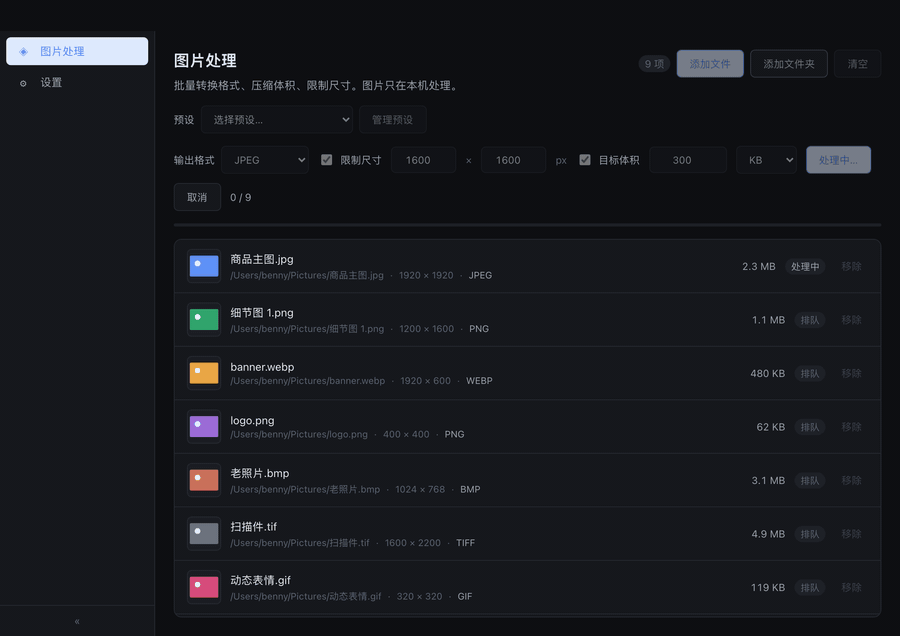
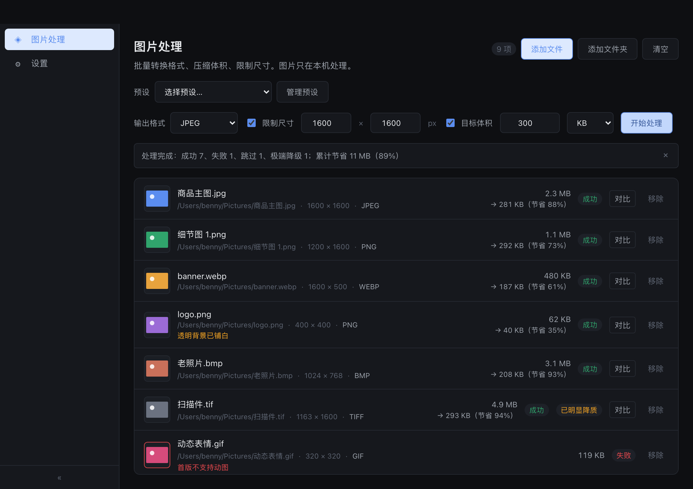
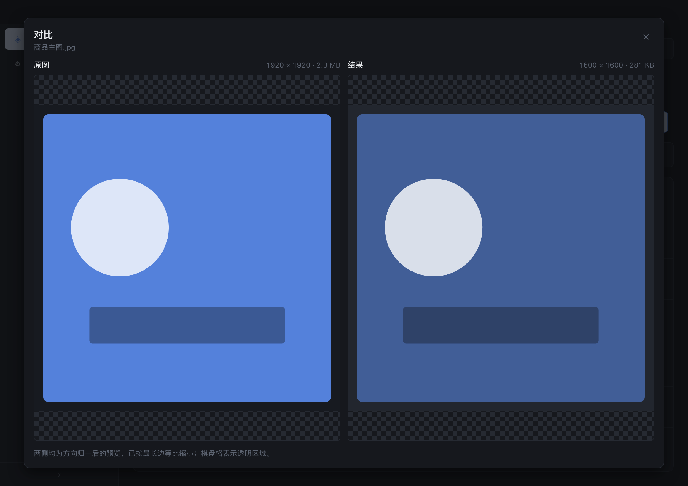
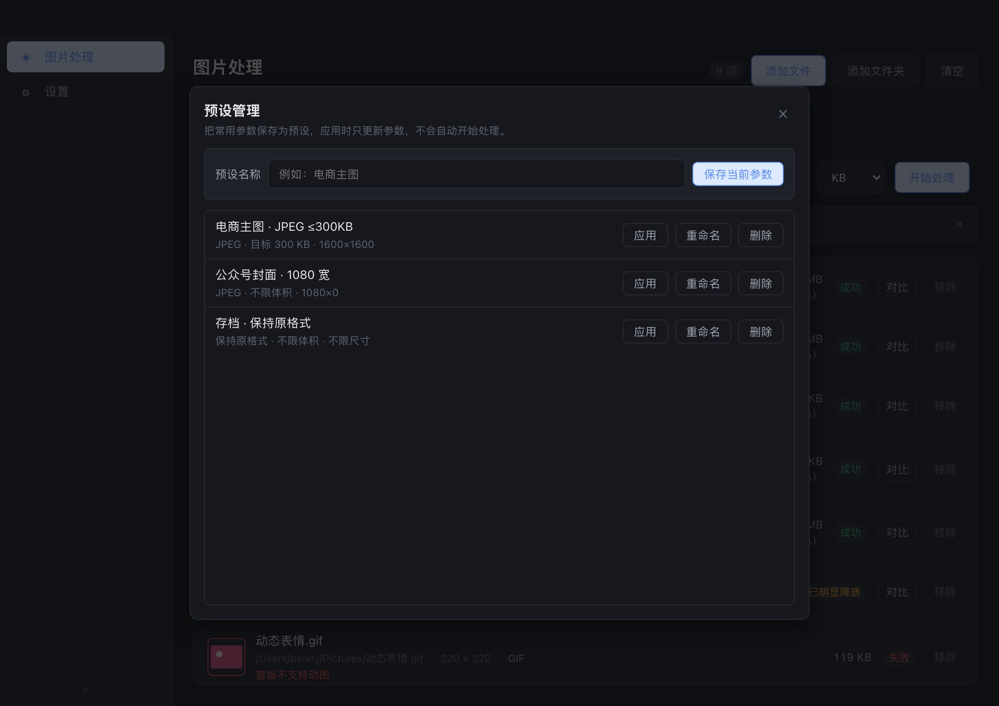

# 图片工坊 / ImageWorkshop

**本地批量图片处理工具**：一次拖入文件或文件夹，批量转换格式、压缩到目标体积、按宽高上限等比缩放。图片只在本机处理，不上传、不联网、不采集遥测。



*上图为示例数据下的界面录制（队列 9 项，规则：JPEG + 目标体积 300 KB + 宽高盒 1600 px）。可见进度 4/9、逐项状态机（成功 / 处理中 / 排队）、节省比例与「透明背景已铺白」提示。*

> **ImageWorkshop** is a desktop batch image tool for macOS, Windows and Galaxy Kylin: convert formats,
> compress to a target file size, and fit images into a width/height box — entirely offline.
> Built with Wails v2 (Go + Vue 3). No upload, no telemetry, no network access at runtime.

| 平台 | 安装包 | 系统要求 |
|---|---|---|
| macOS | `ImageWorkshop.dmg` | macOS 10.13+（Universal 二进制） |
| Windows | `ImageWorkshop-<版本>-windows-amd64.exe`（NSIS 安装器） | Windows 10/11 + WebView2 运行时 |
| 银河麒麟 | `ImageWorkshop_<版本>_amd64.deb` | Kylin V10 SP1（2203）x86_64，glibc 2.31，WebKitGTK 4.0 |

---

## 能做什么

三类规则可以单独用，也可以同时用；同一批里混着不同尺寸、不同格式的图片是正常用法。

| 能力 | 行为 | 边界 |
|---|---|---|
| **格式转换** | 输出 JPEG / PNG / WebP；选「保持原格式」时 JPEG/PNG/WebP 沿用源格式，BMP/TIFF/静态 GIF 落 PNG | 格式以**内容探测**为准，扩展名只用于导入预筛；扩展名与内容不一致时按内容处理并在队列提示 |
| **目标体积** | 优先搜索能达标的**最高质量**，质量到底仍超标时逐步缩小尺寸；PNG 只做无损压缩 + 缩尺寸，不做调色板量化 | 1 KB – 1 GB；目标低到无法达标时该张失败且不产出文件 |
| **宽高上限盒** | 等比缩放进盒内，不裁切、不拉伸、不放大 | 1 – 65535 px；与目标体积冲突时**体积优先**，尺寸可继续缩小 |

输入支持 **JPEG · PNG · WebP · BMP · TIFF · 静态 GIF**（AVIF/HEIC 与动图不支持，见「已知限制」）。

处理时还会自动做这几件事，都是不可逆的取舍，写清楚：

- **方向归一**：读取 EXIF 拍摄方向并按 8 种方向旋转/翻转，输出不再依赖方向标签。
- **隐私剥离**：输出是全新编码，不含 GPS、相机型号、拍摄时间等 EXIF；首版**不保留 ICC** 色彩配置（广色域图可能轻微偏色）。
- **透明铺白**：透明图转 JPEG 时透明区域铺白底，并在队列中标注「透明背景已铺白」。
- **永不覆盖源文件**：输出写在源文件同目录，命名 `<原名>-out.<ext>`，重名依次 `-out-2`、`-out-3`；先写同目录临时文件再原子落位，失败或取消不留半成品。
- **已达标跳过**：源文件已满足体积与尺寸且不需要转格式时标记「已达标」，不产出、也不改动源文件。

批量层面：单张失败只影响该张，整批继续；结束汇总成功 / 失败 / 跳过 / 取消 / 极端降级数量与累计节省；取消在**当前文件完成后**生效。预设存 SQLite，上次使用的参数在重启后恢复。

## 界面

<table>
  <tr>
    <td width="50%">
      
      <b>批次结果</b><br>
      汇总条给出成功/失败/跳过/极端降级与累计节省比例；每行显示原体积 → 输出体积与节省百分比，
      并标出「已明显降质」「透明背景已铺白」「首版不支持动图」等具体原因。
    </td>
    <td width="50%">
      
      <b>单张对比</b><br>
      原图与结果并排，两侧均为方向归一后的预览并按最长边等比缩小，棋盘格表示透明区域，
      同时给出两侧的尺寸与体积。批次进行中也可以查看已完成项的结果。
    </td>
  </tr>
  <tr>
    <td colspan="2">
      
      <b>预设管理</b><br>
      把常用参数存成命名预设（创建 / 应用 / 重命名 / 删除），应用预设只改参数、不会自动开始处理；
      参数改变后已有结果会标记为「结果已过期」。
    </td>
  </tr>
</table>

*以上截图由当前构建的前端渲染，队列为示例数据。*

## 使用

1. 把文件或文件夹拖进窗口（或用「添加文件 / 添加文件夹」）。文件夹递归扫描，跳过隐藏项与符号链接，按路径排序去重。
2. 选规则：输出格式、目标体积、宽高上限，至少给一条。
3. 点「开始处理」。默认 2 个 worker 并行，界面保持可滚动、可查看已完成结果。
4. 到源文件同目录取 `-out` 结果。

## 从源码构建

| 依赖 | 版本 | 说明 |
|---|---|---|
| Go | ≥ 1.26 | `go version` 确认 |
| Node | ≥ 20 | `node --version` 确认 |
| Wails CLI | v2.15+ | `go install github.com/wailsapp/wails/v2/cmd/wails@latest` |
| 平台依赖 | — | Windows 需 WebView2；Linux 原生构建需 `libgtk-3-dev libwebkit2gtk-4.0-dev`；macOS 上打 Linux 包需 Docker |

```bash
make dev          # 开发态（前端热更新）
make build        # 编译当前平台产物
make test         # Go 测试（含架构护栏）
make lint         # 静态检查：gofmt + Go 护栏 + go vet + ESLint + vue-tsc
make smoke        # 冒烟：构建 → 启动 → 断言产物 → 清理
```

> 首次 clone 后先跑 `make build` 再跑 `make test`：根包用 `//go:embed` 嵌入 `frontend/dist`，
> 该目录不入库；`make test` / `make lint` 缺它时会直接告诉你修复命令。

打包与发布：

```bash
make package os=macos                 # .dmg（仅 macOS 可产）
make package os=windows               # NSIS .exe，默认 scope=user（免管理员）
make package os=linux                 # .deb；macOS 上自动经 Ubuntu 20.04 容器构建
make linux-deb                        # 同上的语义化入口
bash scripts/release.sh 0.1.0         # 写版本号 + 三平台打包 + 生成发布说明
```

- **产物位置**：`build/bin/`。版本号单一真相是 `wails.json` 的 `info.productVersion`，
  由 `scripts/build.sh` 同时渲染进安装包与注入进二进制（四处同源，有护栏核对）。
- **麒麟 `.deb`**：安装到 `/usr/bin/ImageWorkshop`，含 desktop entry 与 hicolor 图标，
  声明 `libc6 (>= 2.31), libgtk-3-0, libwebkit2gtk-4.0-37 (>= 2.28.1)`。构建固定
  Ubuntu 20.04 / WebKitGTK 2.28.1 以匹配麒麟的 glibc 与 WebKit，不能跟随宿主发行版漂移。
- **自动发布**：`git tag v0.1.0 && git push origin v0.1.0` 触发 `release.yml`（先跑静态检查，
  再由 macOS / Windows 两条腿打包并创建 Release）。打 tag 前先用
  `bash scripts/set-version.sh 0.1.0` 把版本号提交进仓库。
- **CI**：`build.yml` 在 push/PR 跑静态检查 + macOS/Windows 编译 + Linux `.deb` + 生成器端到端验证。

## 工程约束

这个仓库把「约定」编译成「会红的检查」，改动前先读 [`AGENTS.md`](AGENTS.md)（跨端铁律）、
[`CLAUDE.md`](CLAUDE.md)（Go 侧）与 [`frontend/CLAUDE.md`](frontend/CLAUDE.md)（Vue 侧）；
代码导航见 [`docs/map.md`](docs/map.md)。

- **单一真相**：模型清单在 `internal/model`，依赖清单在 `deps.yaml`，数据目录在 `internal/appdir`，
  版本号在 `wails.json`。前端镜像只允许复制常量与类型，不允许复制逻辑。
- **契约镜像校验**：错误码 / 事件动作 / 分页 / 输出格式 / 处理状态 / 尺寸盒 / 目标体积等常量由
  `internal/guard/parity_test.go` 双向核对，Go 改了前端没跟上即失败。
- **接线不静默缺失**：日志桥接、拖拽开关、版本注入入口、Go 事件与前端订阅、启动底色与设计令牌
  等「漏了不会报错」的链路，都有对应的会红检查（`internal/guard/wiring_test.go`）。
- **护栏感知自己瞎了**：任何解析源码做断言的护栏，解析到 0 个结果一律报错，而非静默通过。
- **分层纪律**：绑定层不碰数据库（经 service），model 是叶子层，渲染层不 import node 能力、不硬编码色值。

技术栈：Wails v2（Go 1.26 + gorm/SQLite 纯 Go 驱动，跨平台无 CGO 图像依赖）· Vue 3 + Vite + TypeScript
+ Pinia + Vue Router（hash 模式适配 `file://` 打包）· 暗色优先的设计令牌体系。

## 已知限制

- **不支持 AVIF / HEIC**：避免引入三平台的系统编解码器依赖。
- **不支持动图**：多帧 GIF / WebP 直接标记失败并说明原因，不静默取第一帧。
- **不保留 ICC 色彩配置**：输出是全新编码，广色域图片可能轻微偏色。
- **未做代码签名与公证**：macOS 产物为 ad-hoc 自签，分发给他人时 Gatekeeper 会拦截，
  本机自用需手动允许。正式发布需补开发者签名与公证。
- **麒麟尚未真机验收**：`.deb` 已在 Ubuntu 20.04 环境安装验证并由 CI 产出，
  但真机安装、启动、拖拽与一次真实处理仍未完成。
- **macOS 关闭即退出**：Wails v2 的 `NSApplication` delegate 与所有 systray 库互斥，
  macOS 不提供托盘。Windows 关闭窗口隐藏到托盘；麒麟在真机确认托盘可用前同样关闭即退出。
- **窗口位置不持久化**：只记住尺寸与最大化状态。
- **tag 发布暂不含 Linux `.deb`**：`build.yml` 会产出并上传 artifact，接入 Release 在排期中。
- **应用标识**：Go module 仍为 `file-processor`（产品名为图片工坊 / ImageWorkshop）；
  macOS bundle id 目前是占位值 `com.example.imageworkshop`，发布前必须替换为公司域名。

---

## 附：工程基座

本仓库由一套 Wails + Vue 脚手架实例化而来，保留了它的工程能力，日常开发用不到也可以忽略：

```bash
make gen name=<module>   # 从 _example/ 模板生成 model + service + 绑定 + 页面，并注入注册表/路由/菜单
make verify-gen          # 生成器端到端验证（连生两个模块 → 生成绑定 → 编译 → 护栏）
bash scripts/init.sh myapp [com.mycompany]   # 用同一套基座实例化一个新项目
```

基座能力清单与搭建经验见 [`docs/脚手架功能说明.md`](docs/脚手架功能说明.md) 与
[`docs/脚手架搭建经验.md`](docs/脚手架搭建经验.md)；Windows WebView2 离线部署见
[Microsoft 文档](https://learn.microsoft.com/microsoft-edge/webview2/concepts/distribution)。
